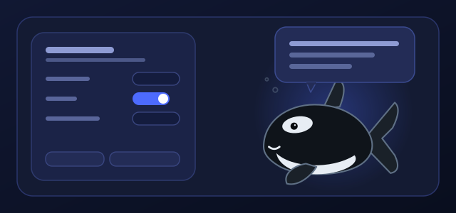

# DeepSeek orca companion

A small orca that lives in your DeepSeek Harness window: it cruises while you think,
taps at a laptop while a turn runs, raises a fin when the agent waits for you,
celebrates finished turns, frowns at failures, and naps when everything is quiet.



*Original minimalist artwork drawn for this plugin.*

## Features

- **Six states** — resting, working, waiting, celebrating, sleeping and error.
  A working-session count appears as a badge; cancelled and failed turns are not
  celebrated as successes.
- **Waiting knows why** — an approval request shows a check badge, a question or
  plan review shows a question badge, with their own phrases.
- **Decide without switching** — when another session needs approval, a compact
  card appears next to the companion with the action, the session name and
  **Allow once** / **Reject** buttons. The decision goes to that session's pending
  request; nothing is approved automatically.
- **Three looks** — orca, dolphin or humpback, one switch in the settings. The
  artwork is a restrained, flat illustration rather than a cartoon sticker.
- **Eyes follow the pointer**, so the animal feels alive without any extra motion.
- **Drag it anywhere**; the position is stored relative to the window, so the
  companion keeps its place when the window is resized.
- **Right-click** (or press <kbd>Enter</kbd>) for settings: session scope, look,
  size, gentle animations, completion sound and nap delay.
- **Arrow keys** move the companion by pixels (<kbd>Shift</kbd> for bigger steps).
- **Optional sound** — an approval signal (a distinct double note, **on by
  default**) and, separately, a completion "ding" with a falling version for
  failures. Both are synthesized with Web Audio (no files) and share one volume;
  the completion sound starts off.
- **First-run tip** explains the right-click menu once, at the first calm moment
  rather than over a running turn.
- **English and Russian** interface and phrases, following the DSH language.
- **Hide and restore** — tuck it away and bring it back with one click.
- **Cannot break the app**: the overlay host is a zero-sized, click-through
  element, and a React error boundary plus guarded effects mean a failure can
  only remove the companion, never the surrounding UI.

## Install

Requires DeepSeek Harness 0.2.2-rc.4 or newer; 0.3.0 and later are not claimed
yet.

Through the plugin index, in **Plugins → Discover**: choose **Add index source**
and enter

```
https://saylordevs.github.io/dsh-plugin-deepseek-orca/index.json
```

then **Install** on the DeepSeek orca companion card. The index pins an exact
commit.

From a terminal, with the `dsh` CLI:

```sh
dsh plugin --profile <profile> add github:saylordevs/dsh-plugin-deepseek-orca
```

### Local folder

1. Open **Plugins** in DSH and choose **Add plugin** → local directory.
2. Point it at this folder: `dsh-plugin-deepseek-orca`.
3. Enable the **DeepSeek orca companion** row, reload the window, and open a session.

The orca appears in the bottom-right corner of the window.

## Usage

| Action | Result |
| --- | --- |
| Click the orca | A greeting bubble |
| Right-click / <kbd>Enter</kbd> | Settings panel |
| Drag | Move it; the position is saved |
| Arrow keys | Nudge the orca; <kbd>Shift</kbd>+arrow moves further |
| <kbd>Esc</kbd> | Close settings |

**Follow** chooses what the companion watches:

- *All sessions* — counts every ordinary session on this host and reacts to any
  completed or failed turn among them.
- *Current session* — only the conversation you are looking at.

Completed turns are celebrated only when the companion saw the turn start, so
opening a session with an old finished turn never triggers a fake celebration.
Cancelled and blocked turns are ignored; failed turns get the frowning state.

## Privacy and runtime boundaries

- Reads session status, turn boundaries (`turn/start`, `turn/end` and the end
  reason) and the details of a pending approval (tool name and the reason the
  requester supplied) so the card can describe it. It never reads, stores or
  forwards message text, tools, files or attachments.
- Answers an approval only when you press **Allow once** or **Reject**; the
  request itself still lives in its own session and disappears there too.
- Keeps local preferences in `localStorage` under `dsh-plugin-deepseek-orca:v1`.
- Makes no model calls, opens no ports, and sends no telemetry.
- All sounds are synthesized locally with Web Audio; no audio files are
  downloaded and nothing is recorded.
- Does not speak out loud: this build has no text-to-speech, by design.

## Compatibility

- Written against DSH `0.2.2-rc.5` on Windows (DSH Desktop).
- Uses the public Client surfaces `shell.overlay`, `ctx.sessions`, `ctx.uiSession`,
  `ctx.connection` and `ctx.locale`. Other DSH versions are untested; if a
  surface is missing the orca degrades to a static companion rather than failing.
- Requires the Web client's `shell.overlay` slot, which the shipped layout
  provides.

## Development

```sh
# Unit tests (Node 20+, no dependencies)
npm test
```

`tools/preview.html` renders the orca outside DSH with the same stylesheet: open
it in a Chromium-based browser and use the buttons to cycle states, the settings
panel and both languages. It does not connect to DSH.

Regression covered by the tests: retaining a session publishes a new session list
synchronously, so the feed marks a session before retaining and guards re-entrant
publishes. Without that guard the overlay recursed until the whole page failed.

## License

- **Code:** MIT, see [LICENSE](LICENSE).
- **Orca artwork and icon:** original artwork created for this plugin and
  distributed under the same MIT license.
