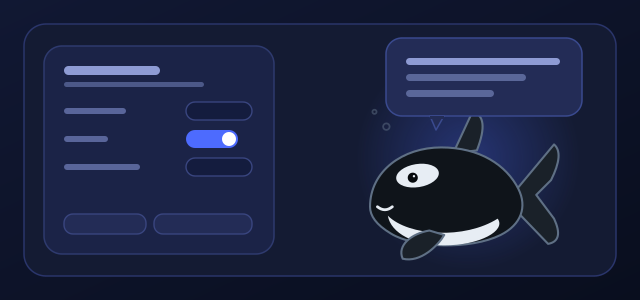

# Косатка-компаньон DeepSeek

Маленькая косатка, которая живёт в окне DeepSeek Harness: плавает, пока вы думаете,
стучит по ноутбуку, пока идёт ход, поднимает плавник, когда агент ждёт вашего
ответа, радуется завершённым задачам, хмурится при ошибках и засыпает, когда всё
спокойно.



*Оригинальная минималистичная графика, нарисованная для этого плагина.*

## Возможности

- **Шесть состояний** — отдых, работа, ожидание, радость, сон и ошибка.
  Число работающих сессий показывается значком; отменённые и упавшие ходы не
  выдаются за успех.
- **Ожидание понимает причину** — запрос подтверждения показывает значок с
  галочкой, вопрос или проверка плана — значок с вопросом, со своими фразами.
- **Решение без переключения** — когда подтверждение нужно в другой сессии, рядом
  появляется компактная карточка с описанием действия, именем сессии и кнопками
  **Разрешить** / **Отклонить**. Решение уходит в запрос той сессии; автоматически
  ничего не подтверждается.
- **Три вида** — косатка, дельфин или горбач, один переключатель в настройках.
  Графика спокойная, плоская иллюстрация, а не мультяшный стикер.
- **Глаза следят за курсором**, животное кажется живым без лишней анимации.
- **Перетаскивание** в любое место окна; позиция хранится относительно окна,
  поэтому компаньон остаётся на месте при изменении размера.
- **Правый клик** (или <kbd>Enter</kbd>) открывает настройки: охват сессий, вид,
  размер, мягкие анимации, звук и задержка сна.
- **Стрелки** двигают компаньона по пикселям (<kbd>Shift</kbd> — крупнее шаг).
- **Необязательный звук** — сигнал подтверждения (отдельный двойной «бип»,
  **включён по умолчанию**) и отдельно «дзынь» завершения с нисходящим вариантом
  для ошибок. Оба синтезируются через Web Audio (без файлов) и делят одну
  громкость; звук завершения изначально выключен.
- **Подсказка при первом запуске** один раз объясняет меню по правому клику — в
  первый спокойный момент, а не поверх работающего хода.
- **Английский и русский** интерфейс и фразы, вслед за языком DSH.
- **Скрыть и вернуть** — компаньон убирается в угол и возвращается одним нажатием.
- **Не может сломать приложение**: хост оверлея — элемент нулевого размера,
  пропускающий клики, а React-граница ошибок и защищённые эффекты позволяют
  сбою убрать только компаньона, но не окружающий интерфейс.

## Установка

### Локальная папка

1. Откройте **Plugins** в DSH и выберите **Add plugin** → локальный каталог.
2. Укажите папку `dsh-plugin-deepseek-orca`.
3. Включите строку **Косатка-компаньон DeepSeek**, перезагрузите окно и откройте
   сессию.

Косатка появится в правом нижнем углу окна.

## Использование

| Действие | Результат |
| --- | --- |
| Клик по косатке | Пузырь с приветствием |
| Правый клик / <kbd>Enter</kbd> | Панель настроек |
| Перетаскивание | Перенос; позиция сохраняется |
| Стрелки | Сдвиг на несколько пикселей, <kbd>Shift</kbd> — дальше |
| <kbd>Esc</kbd> | Закрыть настройки |

**Следить за** задаёт охват:

- *Всеми сессиями* — считает все обычные сессии на этом хосте и реагирует на
  любой завершённый или упавший ход.
- *Текущей сессией* — только открытый разговор.

Радость показывается только если компаньон видел начало хода, поэтому открытие
сессии со старым завершённым ходом не вызывает ложного праздника. Отменённые и
заблокированные ходы игнорируются, упавшие — дают хмурое состояние.

## Приватность и границы работы

- Читает состояние сессий, границы ходов (`turn/start`, `turn/end` и причину
  завершения) и данные запроса подтверждения (имя инструмента и причину, которую
  передал запрашивающий), чтобы описать действие в карточке. Текст сообщений,
  инструменты, файлы и вложения не читаются, не хранятся и не передаются.
- Отвечает на подтверждение только когда вы нажимаете **Разрешить** или
  **Отклонить**; сам запрос живёт в своей сессии и исчезает там же.
- Локальные настройки лежат в `localStorage` под ключом
  `dsh-plugin-deepseek-orca:v1`.
- Никаких запросов к модели, открытых портов и телеметрии.
- Все звуки синтезируются локально через Web Audio: аудиофайлы не скачиваются,
  ничего не записывается.
- Не говорит вслух: в этой сборке нет синтеза речи — так задумано.

## Совместимость

- Написано под DSH `0.2.2-rc.5` на Windows (DSH Desktop).
- Используются публичные клиентские интерфейсы `shell.overlay`, `ctx.sessions`,
  `ctx.uiSession`, `ctx.connection` и `ctx.locale`. Другие версии не проверялись;
  если интерфейса нет, косатка остаётся статичным компаньоном и не ломает UI.
- Нужен слот `shell.overlay`, который предоставляет штатный layout.

## Разработка

```sh
# Модульные тесты (Node 20+, без зависимостей)
npm test
```

`tools/preview.html` показывает косатку вне DSH с тем же стилем: откройте файл в
Chromium-браузере и переключайте состояния, панель и языки. К DSH страница не
подключается.

Регрессионный тест: удержание сессии синхронно публикует новый список сессий,
поэтому фид помечает сессию до удержания и защищает публикацию от повторного
входа. Без этой защиты оверлей уходил в рекурсию, пока не падала вся страница.

## Лицензия

- **Код:** MIT, см. [LICENSE](LICENSE).
- **Графика косатки и иконка:** оригинальная, создана для этого плагина и
  распространяется по той же лицензии MIT.
